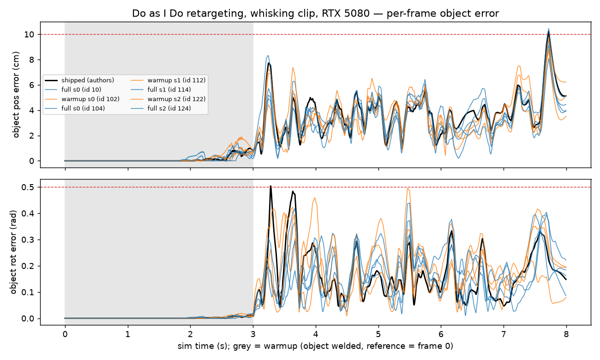

# Do as I Do — an independent reproduction

An independent reproduction of *Do as I Do: Dexterous Manipulation Data from Everyday Human
Videos* (Paliwal, Etukuru, Liang, Abbeel, Shafiullah, Malik — UC Berkeley, 2026;
[arXiv 2606.19333](https://arxiv.org/abs/2606.19333); code
[malik-group/do-as-i-do](https://github.com/malik-group/do-as-i-do)). The paper turns a single
RGB video of a human hand into a physically valid trajectory for a 22-DoF robot hand. This
repository is not affiliated with the authors.

Maintained by [Anand Shrivastava](https://www.linkedin.com/in/anand-shrivastava-07620561/).

## Status

| Stage | What | Status |
|---|---|---|
| R1 | Physics retargeting on the authors' shipped inputs, RTX 5080 | **Done** 2026-09-26 · [r1/RESULTS.md](r1/RESULTS.md) |
| R2 | Reconstruction of the shipped clip, compared with the authors' output, then retargeting of our own reconstruction end to end | **Done** 2026-09-26 · [r2/RESULTS.md](r2/RESULTS.md) · hand pose uses the authors' HaWoR output until the MANO licence is granted |
| R3–R7 | The paper's tables, a metric-depth experiment, the 100DOH survival funnel, a data-generation efficiency Pareto, and a port to the SO-101 arm | Planned · [PLAN.md](PLAN.md) |

## Findings so far

Measured on one clip (whisking). Details and raw rows are in each stage's `RESULTS.md`.

- **Retargeting reproduces.** Object error 2.20 ± 0.12 cm against the authors' 2.39 cm, at about
  8 min and 6.6 GB per clip on a 16 GB RTX 5080.
- **The logged error averages in 600 warmup frames**, which makes it about 36% lower than the
  error on the frames that track the video. Comparisons across methods need both numbers.
- **Warmup decides success on this clip.** Without it the hand starts closed through the object
  and the contact solver ejects it: plain SPIDER fails 0/3, the full method succeeds 4/4.
- **A fixed seed does not reproduce on the GPU.** MuJoCo Warp's contact solve is not
  bit-deterministic, so repeat-run spread has to be measured like seed spread.
- **Reconstruction reproduces shape and position** (0.4–0.6 cm Chamfer, 0.95 cm median path
  difference) **but not orientation**: 7.6° at the anchor frame, 44° at 85–125 frames from it,
  consistent with drift from the tracker chaining each pose from the previous one.
- **Render-IoU does not predict where the pose is wrong** on this thin object (rank correlation
  −0.03 with orientation disagreement), so it is a weak per-frame quality signal here.
- **88–89% of the reconstructed path's jitter is along the camera ray**, in our run and in the
  authors': monocular depth is the weak axis.
- **End to end, our own reconstruction retargets successfully**, with 63% higher post-warmup
  rotation error than the authors' reconstruction.
- **The transition penalty's rest branch never fires on this clip**: the in-hand gate reads the
  whisk as held on 100% of frames, which is why R1 measured no effect from it.
- **Cost:** reconstruction peaks at 23.4 GB and tracking is 78% of its time. About $0.65 of
  rented GPU per second of video, hand pose excluded. A fresh build of the release hits four
  breakages today; the fixes are in `r2/pod_setup.sh` and `r2/run_recon.sh`.

*Per-frame object error for every R1 run (black: the authors' shipped result). Grey is warmup,
where the object is welded. Every run, the authors' included, spikes to about 10 cm at
t ≈ 7.7 s, the last frame of the real reference.*

## Reproducing

- **R1** (a CUDA GPU with 16 GB): `r1/setup.sh` clones the release and builds the environment;
  `r1/ablation.sh` runs every arm and seed through `r1/r1_run.py`; `r1/analyze.py` builds the
  table and the figure.
- **R2** (24 GB or more: the measured peak is 23.4 GB, and the upstream README asks for 32 GB;
  run here on a 96 GB RTX PRO 6000): `r2/pod_setup.sh` builds the environments with the four
  fixes; `r2/fetch_weights.sh` downloads the weights (SAM 3 and SAM 3D are gated on Hugging
  Face); `r2/run_recon.sh` runs the reconstruction stage by stage; `r2/compare.py` compares it
  with the authors' output; `r2/retarget_ours.sh` retargets it.

Model weights, MANO files (licence) and raw `.npz` trajectories are not in this repository. The
scripts recreate them.

## Files

| File | What it is |
|---|---|
| [READING.md](READING.md) | The paper read against its released code, with evidence tags: [P] paper · [S] source · [I] inferred · [M] measured |
| [PLAN.md](PLAN.md) | Replication stages R0–R7 and hardware tiers |
| [r1/](r1/) · [r2/](r2/) | Scripts, results and small artifacts for each stage |

## Credits and licences

The pipeline, the whisking demo clip and the authors' shipped outputs come from
[malik-group/do-as-i-do](https://github.com/malik-group/do-as-i-do) (MIT). Retargeting builds on
SPIDER (CC BY-NC 4.0). This repository contains the replication's scripts, notes and measured
outputs, including small derived artifacts of the demo clip for comparison.
